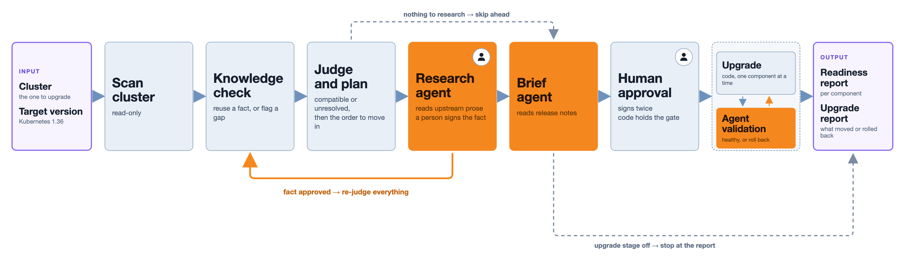
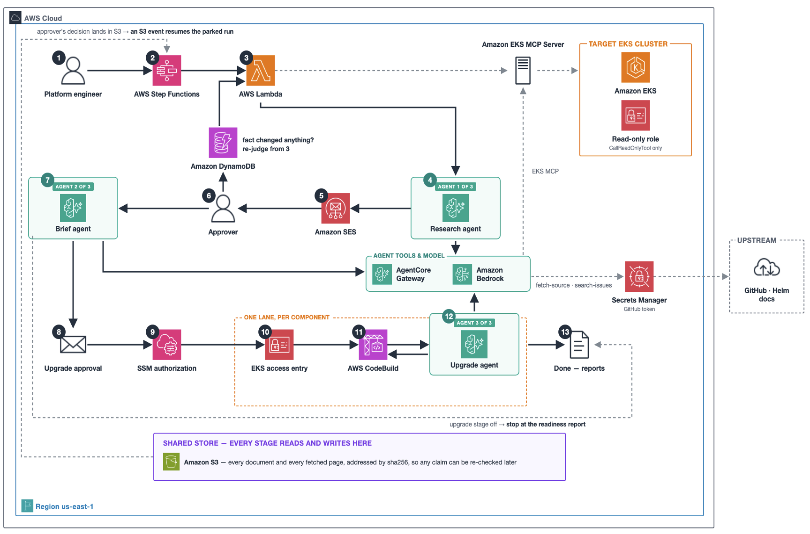

# Agentic EKS add-on upgrades - with human approval

> [!IMPORTANT]
> This is sample code for demonstration and education, not production-ready. Review it with your
> security team and test it on a non-production cluster first.

## What is this?

A workflow that finds every add-on on an Amazon EKS cluster, checks whether each one is compatible
with the Kubernetes version you are upgrading to, and plans the order to move them in. If you turn
it on, it also upgrades the approved add-ons one at a time, with health checks and automatic
rollback. **Agents read; deterministic code decides; a person signs.**

AI agents on Amazon Bedrock AgentCore research each project's own documentation and summarise its
release notes. AWS Step Functions and AWS Lambda run every other step as deterministic code, and
nothing an agent proposes is used until a person approves it.

*Orange steps use a model; everything else is deterministic code. The person icon marks where a
human approves.*

## Why?

Before a Kubernetes upgrade, every add-on on the cluster has to be checked by hand:

* Each project publishes compatibility in its own place and format, if at all.
* A Helm chart's version is not its application's version, so the two are easy to mix up.
* Breaking changes and deprecations are spread across many release notes.
* The order matters: some add-ons must move before the control plane, others after.
* There is rarely a record of who approved which version, or why.
* If an upgrade breaks something, rolling back is left to you.

This sample does that work for you: it cites a source for every compatibility answer, computes the
order, summarises what changes, and records every approval.

## Features

* Automatic discovery of EKS managed add-ons and Helm-installed components
* Compatibility facts researched by an agent, with every quote checked against its source page
* Human approval before any researched fact is used
* Deterministic compatibility verdicts and upgrade order
* A brief per upgrade step: release notes, deprecations and known issues
* Optional upgrades behind two signatures: per-step approval, then IAM release authorisation
* One component per upgrade lane, with health checks and automatic rollback
* Read-only agents: no agent holds a permission that can change a cluster
* An audit trail of every fact, approval and upgrade

## Architecture

Each stage is described in [Architecture](docs/architecture.md).

## See it in action

Screenshots from a real run, in the order you meet each screen, are in
[docs/images/walkthrough](docs/images/walkthrough/):

1. [Approve a fact](docs/images/walkthrough/01-fact-approval.jpg)
2. [Review the plan](docs/images/walkthrough/02-upgrade-approval.jpg)
3. [Read the brief for a step](docs/images/walkthrough/03-upgrade-step-details.jpg)
4. [Authorise the release](docs/images/walkthrough/04-release-authorisation-email.jpg)
5. [Get the result by email](docs/images/walkthrough/05-upgrade-report-email.jpg)
6. [Check the audit trail](docs/images/walkthrough/06-upgrade-report.jpg)
7. [See the health evidence](docs/images/walkthrough/07-applied-health.jpg)

## Quick start

Follow the full [installation guide](docs/install.md) to deploy the sample, connect your cluster
and walk through your first readiness check, from approving facts to the upgrade report.

## Clean up

Follow the [clean-up guide](docs/cleanup.md) to remove every resource this sample created. It
does not touch your EKS clusters or their add-ons: anything the upgrade lanes moved stays on its
new version.

## Documentation

To learn more, go to the [complete documentation](docs/).

## Contributing

See [CONTRIBUTING](CONTRIBUTING.md) for the repository layout, tests, local checks and how to
report a security issue.

## License

This library is licensed under the MIT-0 License. See the [LICENSE](LICENSE) file.
